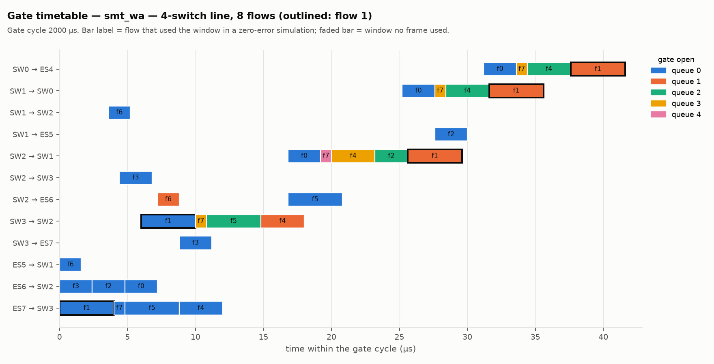
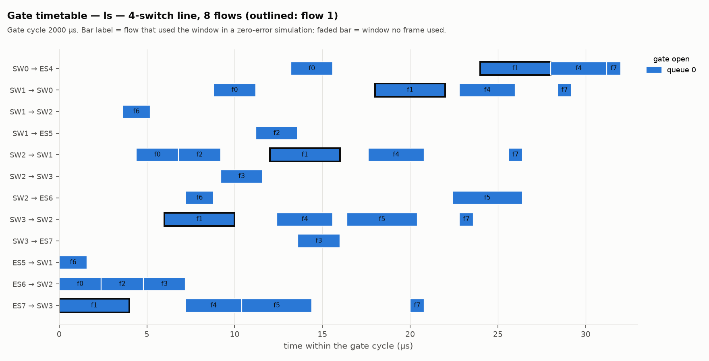
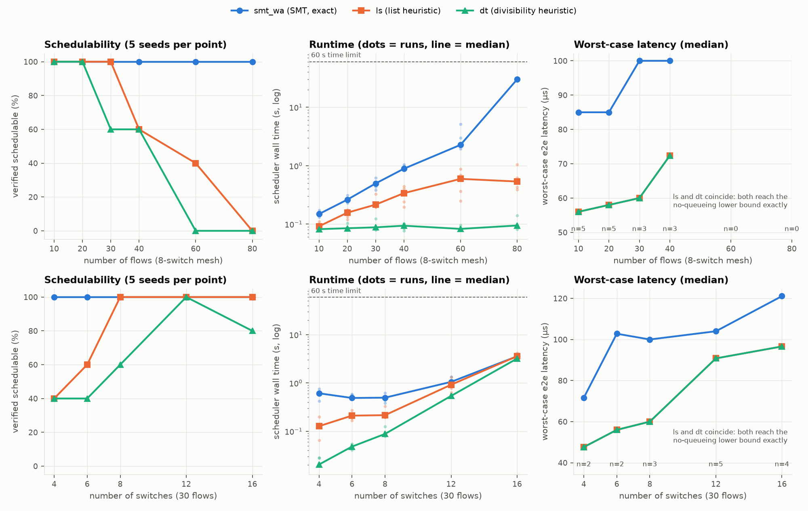
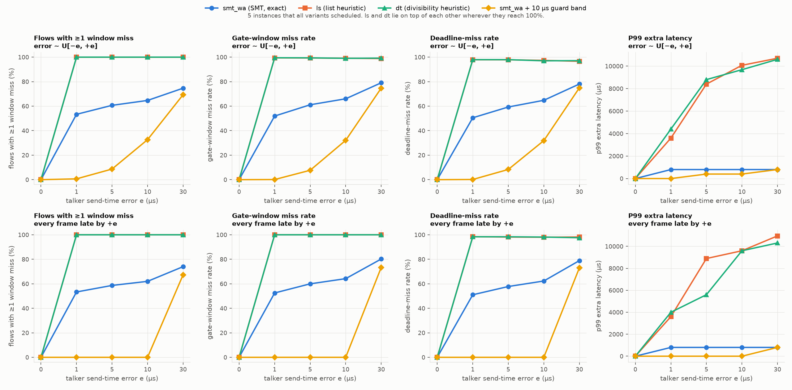
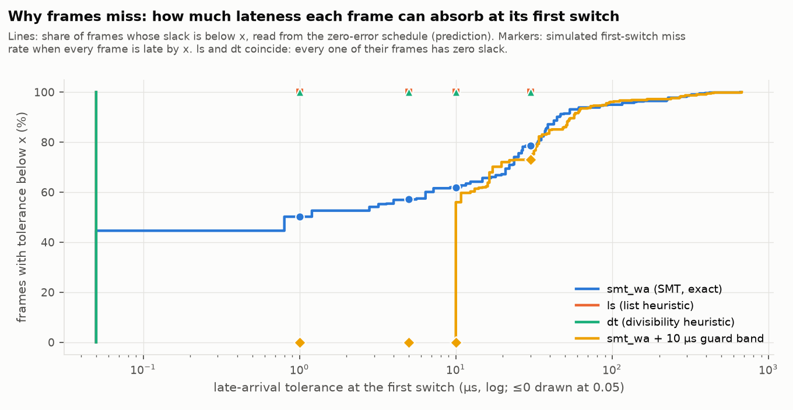

# tsn-qbv-lab

**Visualise, benchmark and stress-test IEEE 802.1Qbv schedules produced by [TSNKit](https://github.com/ChuanyuXue/tsnkit), in simulation only.**

TSNKit (UConn CPS Lab) implements 17 published Time-Sensitive Networking (TSN) scheduling
algorithms behind one interface. This project builds three things on top of it:

1. **A gate-timetable visualiser**: per-port 802.1Qbv gate control lists, drawn and exported as
   standard gate-state entries and Linux `tc taprio` templates.
2. **A reproducible scheduler benchmark**: schedulability, runtime and worst-case latency of
   three schedulers as networks and flow counts grow, with every schedule independently replayed.
3. **A talker send-time error experiment**: what happens to a TSNKit schedule when end stations
   use standard NICs that cannot transmit exactly on time, the problem
   [KeepON (NSDI '26)](https://www.usenix.org/conference/nsdi26/presentation/xue-chuanyu) addresses in hardware.

```bash
./run_all.sh --quick   # ~1 minute: venv, install, 35 tests, all three steps on small instances
./run_all.sh           # full reproduction (~10 min on 2 vCPUs; results already committed in results/)
```

---

## Key results

| | `smt_wa` (SMT, exact) | `ls` (list heuristic) | `dt` (divisibility heuristic) |
|---|---|---|---|
| Verified schedulable, 55 instances with tight deadlines | **55 / 55** | 40 / 55 | 32 / 55 |
| Median runtime at 80 flows, 8-switch mesh | 29.9 s | 0.54 s | 0.09 s |
| Worst-case latency vs. no-queueing lower bound | +27.6 µs (median) | **+0.0 µs (always)** | **+0.0 µs (always)** |
| Frames with zero slack at the first switch | 44.6 % | 100 % | 100 % |
| Flows hit by a ±1 µs talker error (deadline-miss rate) | 53 % (50 %) | 100 % (98 %) | 100 % (98 %) |

Rows 1–3 come from the benchmark (section 2), rows 4–5 from the talker-error study (section 3).

* **Exact vs. heuristic.** `smt_wa` scheduled every instance. Every rejection by the
  heuristics was therefore a heuristic failure, not an infeasible network. The heuristics answer in
  milliseconds; `smt_wa`'s runtime grows about 200× from 10 to 80 flows.
* **The heuristics are latency-optimal and maximally fragile.** `ls` and `dt` hit the
  no-queueing latency lower bound exactly in all 72 schedules they produced, which means no frame
  ever waits, and so no frame can absorb any lateness. A **1 µs** talker error affects every flow.
* **One late frame becomes a permanent delay.** TSNKit sizes each gate window to fit exactly one
  frame. A frame that misses its window takes the next window of its queue, its successor takes the
  one after, and the queue never drains (`tests/test_sim.py::test_one_late_frame_causes_permanent_backlog`).
* **A guard band fixes lateness but not wire contention.** Scheduling `smt_wa` with a 10 µs
  guard band (TSNKit's `E_SYNC`) gives **zero** misses when every frame is up to 10 µs late. With
  ±e errors, though, every flow's first miss (1, 13 and 49 flows at ±1/5/10 µs) is caused by
  **another frame of the same talker** still occupying the wire: a standard NIC sends first-in,
  first-out, so independent errors make neighbouring frames collide and delay each other by up to
  a full frame time (12 µs at 1500 B). Cost of the guard band: only 5 of 10 networks remain schedulable.
* **The mechanism is predictable.** Under the "every frame late by e" model, the simulated
  first-switch miss rate equals the share of frames whose zero-error slack is below e, *exactly*, in
  all 16 non-zero cases (on the compared instances and on all 10).
* **Found and fixed two TSNKit issues** (see [Upstream contribution](#upstream-contribution)).

---

## 1. Gate timetables (802.1Qbv)




Same 4-switch line network and 8 flows, scheduled by `smt_wa` (top) and `ls` (bottom). Each bar is
a gate-open window, coloured by queue and labelled with the flow that used it in a zero-error
simulation. Flow 1 is outlined across its four hops. Two design philosophies are visible at a glance:
`ls` uses one queue and sends each frame on as soon as it arrives (no slack anywhere), while
`smt_wa` spreads flows over five queues and leaves arbitrary gaps between hops.

TSNKit writes one row per window, `(link, queue, start, end, cycle)`. The visualiser converts that
into the 802.1Qbv form, a cyclic list of `(gate-state bitmask, interval)` entries per port, and into
`tc taprio` templates
(`results/gcl_demo/*-gate-control-list.csv`, `results/gcl_demo/*-taprio.sh`):

```
port,link,entry,start_ns,interval_ns,gate_mask_bin,gate_mask_hex
SW0 → ES4,"(0, 4)",0,0,31200,00000000,00
SW0 → ES4,"(0, 4)",1,31200,2400,00000001,01      <- queue 0 open for 2.4 µs (one 300-byte frame)
SW0 → ES4,"(0, 4)",2,33600,800,00001000,08
```

```bash
qbvlab schedule smt_wa task.csv topo.csv --out out
qbvlab gcl task.csv topo.csv out/smt_wa --out gcl.png --highlight-flow 1 --export out/
```

## 2. Scheduler benchmark



**Setup.** TSNKit's own generator on mesh topologies: periods {100, 200, 400, 800} µs, payloads
200–1500 B, tight deadlines (path transmission time + {0, 10, 20, 25, 50} µs), 1 Gbps, 2 µs
switch processing delay. Two sweeps: 10–80 flows on 8 switches, and 4–16 switches with 30 flows.
5 seeds per point, so 55 instances × 3 schedulers = 165 runs, each in its own process with a 60 s limit,
single solver thread.

**What counts as schedulable.** TSNKit reports success *and* our simulator replays the schedule
for 3 hyperperiods with zero error. Every frame must be delivered before its deadline, inside a
gate window of its assigned queue. All 127 schedules TSNKit reported as feasible passed.

**Latency** is compared only on instances that *all three* solved (n shown under each point), so
a scheduler is not rewarded for skipping hard instances. `results/benchmark/raw.csv` also
holds a per-instance no-queueing lower bound (`latency_lower_bound_us`).

| flows (8-switch mesh) | 10 | 20 | 30 | 40 | 60 | 80 |
|---|---|---|---|---|---|---|
| `smt_wa` schedulable | 100 % | 100 % | 100 % | 100 % | 100 % | 100 % |
| `ls` schedulable | 100 % | 100 % | 100 % | 60 % | 40 % | 0 % |
| `dt` schedulable | 100 % | 100 % | 60 % | 60 % | 0 % | 0 % |
| `smt_wa` median runtime | 0.15 s | 0.26 s | 0.50 s | 0.89 s | 2.3 s | 29.9 s |

Raw data: `results/benchmark/raw.csv`. Aggregates: `results/benchmark/summary.csv`.

## 3. Talker send-time error ("transmission determinism at end devices")

Every TSNKit scheduler writes gate windows for the talkers' own egress ports, so all of them
assume the talker's NIC transmits exactly on schedule. KeepON argues that standard NICs cannot.
Here each talker is a standard NIC: frame *k* of flow *f* goes onto the wire at
`intended + error` (first-in, first-out if the wire is busy), and the switches enforce the schedule.



**Setup.** 8-switch mesh, 30 flows, periods 100–800 µs, deadline = period, 20 hyperperiods (16 ms,
1,760–2,660 frames per instance). Errors e ∈ {0, 1, 5, 10, 30} µs under two models: `U[−e, +e]` per frame and
"every frame late by +e". *Common random numbers*: each frame draws one `u ∈ [−1, 1]` that is reused
for every e and every scheduler, so differences between curves come from the schedules, not
sampling noise. The comparison uses the 5 (of 10) instances that all four variants scheduled
(`summary.csv`); `summary_all_instances.csv` has every instance each variant solved.

**Metrics.** A *gate-window miss* means a frame did not start inside the exact window instance the
schedule gave it, whether it came too late or started early in someone else's window. *Flows
affected* is the share of flows with at least one miss; unlike frame-level rates it doesn't grow
with simulated time (see backlog below). *Extra latency* = delivery time − zero-error delivery time.

| flows affected | ±1 µs | ±5 µs | ±10 µs | ±30 µs | late +1 | late +5 | late +10 | late +30 |
|---|---|---|---|---|---|---|---|---|
| `smt_wa` | 53 % | 61 % | 65 % | 75 % | 53 % | 59 % | 62 % | 74 % |
| `ls` | 100 % | 100 % | 100 % | 100 % | 100 % | 100 % | 100 % | 100 % |
| `dt` | 100 % | 100 % | 100 % | 100 % | 100 % | 100 % | 100 % | 100 % |
| `smt_wa` + 10 µs guard | **0.7 %** | **8.7 %** | **33 %** | 69 % | **0 %** | **0 %** | **0 %** | 67 % |



**Why.** The lines show, for each schedule, how much lateness each frame could absorb at its first
switch (its *slack*, measured from the zero-error run). The markers are the simulated miss rates.
They coincide exactly for the "late" model, so the outcome is fully explained by the slack
distribution:

* `ls`/`dt`: 100 % of frames have zero slack, so any lateness misses.
* `smt_wa`: 44.6 % zero slack, median 0.8 µs. Its robustness is accidental: it is a feasibility
  model with no latency objective, so z3 happens to leave gaps. The price is latency (median
  worst-case 765 µs vs 72 µs for `ls` on the same instances).
* Guard band: slack ≥ 10 µs by construction.

**Backlog.** A missed window costs more than one window: with exact-fit windows the queue never
drains, so every later frame of that flow is also late (p99 extra latency 800 µs for `smt_wa`, one
gate cycle). In `ls`/`dt`, where all flows share queue 0, frames that don't fit the open window block
the queue and the backlog grows without bound. "Lost" in the CSVs means still queued when the
simulation ends.

**First-miss attribution** (`first_miss_*` columns): for each affected flow, the cause of its first
miss is classified as its own error, the talker's wire being busy with a neighbouring frame, a blocked
switch queue, or a downstream hop. For the guard-banded schedule under ±1/5/10 µs, 100 % of first
misses are talker-wire contention. Slack at the switches cannot fix a problem that starts inside
the end station, which is the argument for precise transmit timing at the NIC (e.g. KeepON).

## How it works

```
qbvlab/
  instances.py   seeded wrapper around TSNKit's DatasetGenerator
  runner.py      runs a TSNKit scheduler in a subprocess with a hard time limit (+ guard band)
  _entry.py      subprocess entry; works around the TSNKit E_SYNC issue
  model.py       loaders for TSNKit task/topo and GCL/OFFSET/QUEUE/ROUTE CSV files
  sim.py         event-driven 802.1Qbv simulator, schedule verification, error metrics
  gcl.py         TSNKit windows -> 802.1Qbv gate-state entries -> tc taprio templates
  visualize.py   gate timetable figures
  experiments/   benchmark.py (Step 3), jitter.py (Step 4)
tests/           35 tests (pytest)
upstream/        TSNKit bug report + patch
```

**Simulator.** TSNKit's own simulator (`tsnkit.simulation.tas`) releases frames exactly at their
offsets and steps time in 100 ns slots, so it cannot inject talker errors. `qbvlab.sim` is an
event-driven re-implementation with the *same gate semantics*:
* The active GCL entry is the one with the latest start at or before `t`.
* Only that entry's queue is open.
* The head-of-line frame starts only if the port is idle and the frame fits in the rest of the window.
* A frame can leave the next hop after `tx + t_prop + t_proc`.

With zero error it reproduces TSNKit's simulator **to the nanosecond**: 232 of 232 frames across
`smt_wa`, `ls` and `dt` on a mixed-period instance (`tests/test_sim_vs_tsnkit.py`). Latency is
measured as in `smt_wa`'s deadline constraint, from the first-hop transmission start to the end of
reception at the listener.

**Reproducibility.**
* TSNKit is pinned to commit `8924ff2`.
* Instances are seeded explicitly; TSNKit defines `SEED = 1024` but never uses it.
* Error draws use `numpy.random.default_rng([2026, seed])`.
* Every instance, schedule and CSV behind the figures is committed under `results/`.
* Re-running reuses cached scheduler outputs; delete `results/` to recompute from scratch.

## Upstream contribution

While setting a guard band I found two issues in TSNKit (`upstream/ISSUE.md`, with a 12-line
patch in `upstream/tsnkit-constant-flags.patch`):

1. **Every scheduler CLI rejects the constant flags** (`-e_sync`, `-t_slot`, `-t_proc`, …):
   `parse_command_line_args()` parses before `parse_command_line_constants()` registers them,
   so the program exits with `unrecognized arguments`.
2. **`core.E_SYNC` never reaches `smt_wa`**: `_network.py` copies `E_SYNC` at import time, so
   `Link.t_sync` stays 0, while `at`/`smt_fr`/`smt_pr`/`i_omt` read it at call time.

With the patch, `python -m tsnkit.algorithms.smt_wa task topo -e_sync 100` works and gives a
schedule byte-identical to this project's workaround. Without flags, `smt_wa`, `ls` and `dt` outputs
are byte-identical to unpatched TSNKit. Two tests pin the current upstream behaviour, so the
workaround can be dropped once it is fixed.

## Limitations

* **Simulation only.** Idealised links: no bit errors, no frame preemption (802.1Qbu), no
  best-effort or credit-based traffic, perfectly synchronised switches. Only talkers err.
* **Synthetic error models** (uniform and constant). Real NIC timing error has heavy tails and
  bursts; measured distributions (e.g. KeepON's) would be more faithful.
* **Small samples.** 5 seeds per benchmark point, latency comparisons on 2–5 common instances,
  10 instances (5 common) for the error study. One topology family (mesh) and TSNKit's generator
  distributions.
* **Runtimes** were measured on a 2-vCPU cloud VM with one solver thread. Absolute values will differ.
* `smt_wa`'s latency and slack are whatever z3 returns. Another z3 version may give different schedules.
* Unicast only. Fragmentation (`smt_fr`) is not modelled. Only the three schedulers that need no
  commercial solver (no Gurobi or CPLEX).
* No 802.1Qci per-stream policing, so late frames are never dropped and backlog persists. The talker
  NIC is a single first-in, first-out queue.
* The guard band is uniform per hop (TSNKit's `E_SYNC`), not tailored per talker.

## Ideas for next steps

* A *talker-aware* constraint: space frames of the same talker at least 2e plus one frame time apart,
  and compare it with a uniform guard band.
* Replace the synthetic errors with transmit timestamps measured on a Raspberry Pi 4 (the platform
  KeepON evaluates) or an Intel i210 with and without LaunchTime.
* Add 802.1Qci policing and measure how dropping, rather than delaying, late frames changes the outcome.

## Credits

* **TSNKit** by Chuanyu Xue, Elaine Hu, Tianyu Zhang, Song Han and contributors (UConn CPS Lab), GPL-3.0.
  All scheduling algorithms and the instance generator used here are TSNKit's.
  > C. Xue, T. Zhang, Y. Zhou, M. Nixon, A. Loveless, S. Han. *Real-time scheduling for 802.1Qbv
  > time-sensitive networking (TSN): A systematic review and experimental study.* IEEE RTAS 2024, pp. 108–121.
* **KeepON** motivated the send-time error experiment (section 3):
  > C. Xue, T. Zhang, A. Loveless, S. Han. *KeepON: Supporting Deterministic Traffic on Standard NICs.* USENIX NSDI 2026.
* Scheduling methods: `smt_wa` from Craciunas et al., *Scheduling Real-Time Communication in IEEE
  802.1Qbv Time Sensitive Networks* (RTNS 2016); `ls` from *Heuristic List Scheduler for Time
  Triggered Traffic in Time Sensitive Networks*; `dt` from *Efficient Flow Scheduling for Industrial
  Time-Sensitive Networking: A Divisibility Theory-Based Method* (see TSNKit's `doc/source/schedule.md`).

## License

GPL-3.0-or-later (see `LICENSE`), matching the GPL-3.0 `LICENSE` file of TSNKit, which this project
imports. TSNKit's README badge and `pyproject.toml` say MIT, while its `LICENSE` file says GPL-3.0,
so this project follows the stricter of the two.
